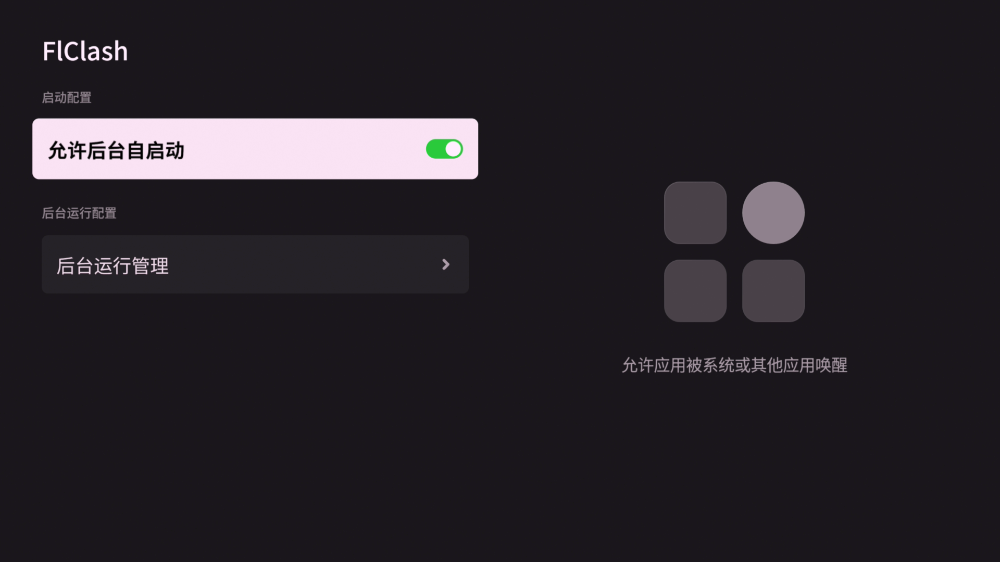
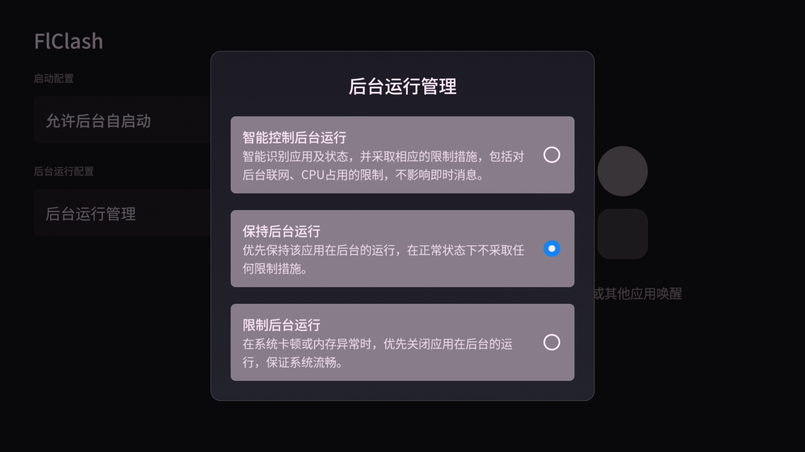
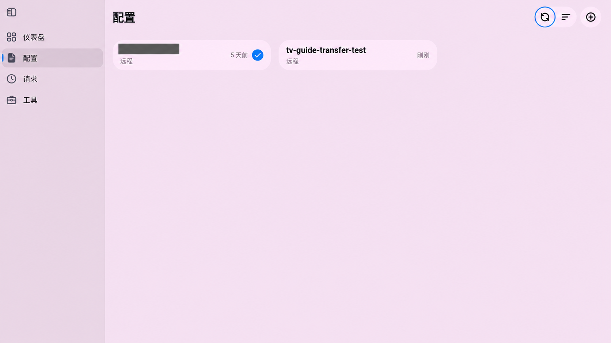
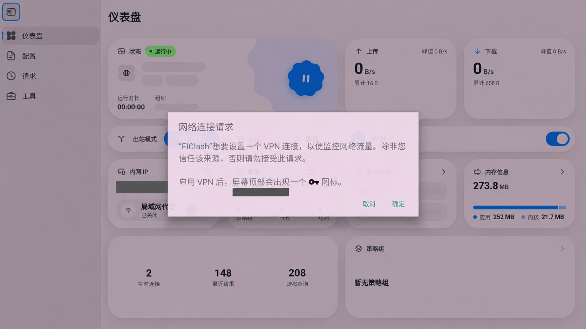

# 本机操作配图

截图来自2026年11月21日的创维75V58F Pro、酷开10.01.260911，均为实机原图。其他固件菜单可能不同。采图没有改变权限或停止过滤，短暂离开播放页后已返回。

## 下载与安装

打开[0.3测试版下载页](https://github.com/koi-lee/tv-home-ad-filter-notes/releases/tag/v0.3-tested)，在Assets中下载TvFilterHelper-0.3-tested.apk、baseline.yaml、tv-filter.yaml及SHA256SUMS.txt。APK约12KB，只是启动助手。还需从[FlClash上游](https://github.com/chen08209/FlClash/releases)准备适配设备的客户端。

APK为本机测试签名，版本名0.3、versionCode3、最低Android API26。它会写入本机酷喵适配参数，且没有自动机型阻断。先完成[新手指南](quick-start.md)的适配检查，再安装；其他机型不应直接启用。已有同包名不同签名应用时会安装失败，请保留原应用并让Agent核对，不能直接卸载。

Mac可在下载目录运行以下命令核对每个文件的SHA256与SHA256SUMS.txt一致。Windows可使用Get-FileHash；未匹配前不要安装。

```sh
shasum -a 256 TvFilterHelper-0.3-tested.apk baseline.yaml tv-filter.yaml
```

由Agent通过已授权ADB安装，或由技术协助者使用电视支持的本地安装方式。USB接口与允许安装入口因机型而异，本项目没有验证通用USB安装路线。不要仅为安装本助手更改路由器。

## 助手开关与手动测试

安装并打开“电视过滤启动助手”。开机开关默认关闭，图中为已有设置后的开启状态。用遥控器选中开关并确认开启，再选择“测试启动并返回首页”。


页面“最多60秒”描述等待VPN过程；页面“不修改播放器数据”指未更改持久化应用数据，助手0.3会写入四项debug属性，详见架构文档。当前图片保留原程序文字。

## 厂商后台自启动

在电视的应用启动管理中分别找到FlClash和电视过滤启动助手，进入对应应用的设置页。图中以FlClash为例，确认“允许后台自启动”已开启，再进入“后台运行管理”。



## 保持后台运行

选择“保持后台运行”，确认圆点处于该项。图中已有蓝色选中标记。FlClash与启动助手均需各自核对。



## FlClash配置导入

2026年11月21日，在本机FlClash的“配置”页面点击右上角加号，实际菜单包含“二维码、文件、链接、从手机发送、自定义”。本机点“文件”后没有取得文件选择器成功打开的证据。因此电视上找不到文件选择器时，可以检查“链接”入口，不需要改动路由器。

先确认电视可访问GitHub下载地址。以下地址固定到v0.3-tested，不随main更新，文件内容与该版本SHA256SUMS.txt对应。

直连基线地址，可复制整行交给Agent或填入链接导入框。

```text
https://github.com/koi-lee/tv-home-ad-filter-notes/releases/download/v0.3-tested/baseline.yaml
```

过滤配置地址。

```text
https://github.com/koi-lee/tv-home-ad-filter-notes/releases/download/v0.3-tested/tv-filter.yaml
```

1. 在“配置”页点击右上角加号，选择“链接”，填入直连基线地址，确认后等待下载。菜单不同则由Agent读取当前页面。
2. 在配置列表找到新条目，核对内容只有MATCH,DIRECT，然后选择该条目作为当前配置。成功标志应包含当前选中标记及客户端没有加载错误，不能只看下载成功。
3. 回到仪表盘，以规则模式启动本地VPN。baseline也在规则模式下将所有请求直连；仪表盘的“直连模式”是另一个开关。
4. 从原首页打开免费节目，验证直连正常。记录结果，再用同样方式导入过滤配置并核对三条精确DOMAIN拒绝加一条MATCH,DIRECT。
5. 选择过滤配置后，确认实际启用嗅探和目标广告域名命中。若客户端有覆盖配置，Agent还需核对覆盖后的有效设置。此配置不含代理节点，策略组为空并不表示导入失败。
6. 回原首页重新打开同一集，分别记录视频广告、倒计时、加载和正片。失败时重新选回之前保存的直连配置。

本机后续测试GitHub Release链接时出现“安全连接失败”，因此不能保证电视能直接下载上述公网地址。已补验下面的本地传输路径，取得HTTP200与新增配置条目。文件选择器仍未完整验证。

链接来源的配置可能带自动更新设置。首次保存后检查更新策略，需固定配置时关闭自动更新并验证离开电脑后仍可运行。不要填入别人家电脑的IP或临时HTTP地址。配置文件来源保持可追踪，更新后重新验收。

## 公网链接失败时，使用电脑本地传输

这一条需要Agent或技术人员操作。先将发布页文件下载到电脑并核对SHA256，只把需要传输的两个YAML文件放入一个临时目录，避免把整个下载目录暴露给临时服务。

电脑终端A运行以下命令。先进入专用传输目录，再启动只监听本机的服务。下面命令不要在包含其他私密文件的目录运行。

```sh
python3 -m http.server 18764 --bind 127.0.0.1
```

电脑终端B设置到已授权电视的ADB反向转发，TV_IP替换为当前核对的电视地址。如果端口已被使用，先核对归属或选择新端口，不能停止其他任务的服务。

```sh
TV_SERIAL='TV_IP:5555'
adb -s "$TV_SERIAL" reverse tcp:18764 tcp:18764
```

在FlClash“配置→右上角加号→链接”中，名称填写便于识别的baseline，链接填写http://127.0.0.1:18764/baseline.yaml。age私钥留空。点击提交，等待列表出现条目。此地址通过ADB回到电脑本机服务，不能换成别人家的局域网IP。

过滤配置用同样方式导入http://127.0.0.1:18764/tv-filter.yaml。先选baseline验证直连，再选过滤配置核对三条拒绝及MATCH,DIRECT。本轮实际新增过滤配置时服务返回200，列表出现tv-guide-transfer-test条目，说明该文件传输与新增路径成功。测试没有重新跑完整的baseline切换验收。



图中左侧选中的是原配置，右侧是本次测试新增条目。图像以真实截图为底稿，经AI辅助遮盖网络地址并核对主要文字，作为界面识别参考。未处理的原图留本地。

导入完成后，检查配置编辑页的自动更新设置，关闭对临时服务的自动更新依赖。配置卡片获得焦点后可尝试遥控器菜单键打开编辑；当前客户端也有上下文菜单。页面不同则让Agent读取当前状态。停止服务前需核对关闭状态；未经确认，不把“已缓存”当成永久可用。

完成传输后，在终端A按Ctrl+C结束服务，并在终端B清理本次转发。

```sh
adb -s "$TV_SERIAL" reverse --remove tcp:18764
```

最后确认本地服务已停止、转发已移除，再按验收清单验证电视重启及电脑离线。本次只新增后清理测试条目，并恢复原有已验收配置，未将临时URL作为日常配置保留。

## 首次VPN授权与已有授权

先确认要启动的是已经核验的FlClash。首次请求本地VPN时，Android通常会出现“连接请求”或类似系统确认，提示该应用可处理网络流量。用户在电视本地阅读并决定是否允许；拒绝或取消后，本次不会取得该授权。

- 已经授权且运行中时，不再次出现弹窗属于可能的正常状态。由Agent确认系统VPN、FlClash进程及实际连接记录。
- 页面只显示应用内部介绍时，继续之后还可能出现系统连接请求；应用介绍不代表系统已授权。
- 仅看到厂商“允许后台自启动”开关，也不能证明VPN已授权。
- 开启失败或提示另一个VPN正在使用时，先核对当前VPN，停止继续试开关，由用户决定如何处理冲突。

经用户明确同意后，本轮先停止过滤、重置FlClash已有VPN授权，再从正常启动入口拍到以下系统弹窗。随后由用户在电视上选择“确定”，核对授权恢复为allow、系统VPN已连接。不要为照图重复重置已经正常工作的授权。



此图以真实截图为底稿，经AI辅助遮盖网络地址并核对弹窗原文及按钮，作为界面参考。原图与权限恢复记录留本地。系统弹窗标题为“网络连接请求”，应用名为FlClash；早期Rethink内部说明页不属于此系统授权步骤。

完成后按[验收清单](quick-start.md#怎样算设置好了)测原首页播放、重启、断电和电脑离线。下载此测试版可以省去本地构建，首次授权、配置与验收仍需完成。
