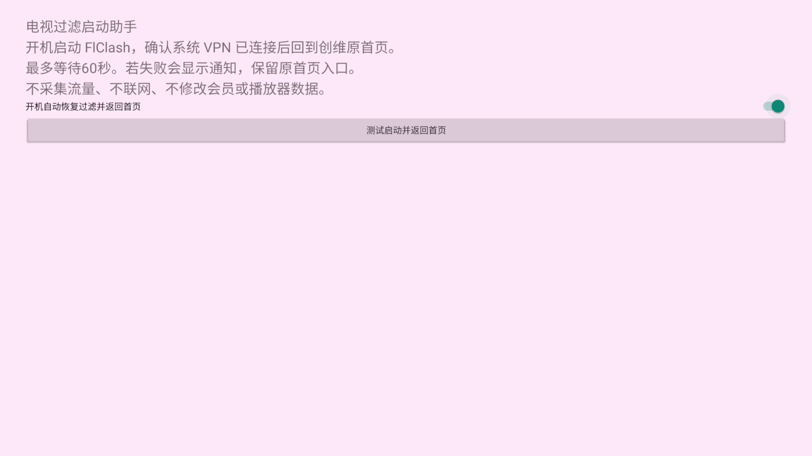

# 本机操作配图

截图来自2026年11月21日的创维75V58F Pro、酷开10.01.260911，均为实机原图。其他固件菜单可能不同。采图没有改变权限或停止过滤，短暂离开播放页后已返回。

## 下载与安装

打开[0.3测试版下载页](https://github.com/koi-lee/tv-home-ad-filter-notes/releases/tag/v0.3-tested)，在Assets中下载TvFilterHelper-0.3-tested.apk、baseline.yaml、tv-filter.yaml及SHA256SUMS.txt。APK约12KB，只是启动助手。还需从[FlClash上游](https://github.com/chen08209/FlClash/releases)准备适配设备的客户端。

APK为本机测试签名，版本名0.3、versionCode3、最低Android API26。它会写入本机酷喵适配参数，且没有自动机型阻断。先完成[新手指南](quick-start.md)的适配检查，再安装；其他机型不应直接启用。已有同包名不同签名应用时会安装失败，请保留原应用并让Agent核对，不能直接卸载。

Mac可在下载目录运行以下命令核对每个文件的SHA256与SHA256SUMS.txt一致。Windows可使用Get-FileHash；未匹配前不要安装。

```sh
shasum -a 256 TvFilterHelper-0.3-tested.apk baseline.yaml tv-filter.yaml
```

由Agent通过已授权ADB安装，或由技术协助者使用电视支持的本地安装方式。USB接口与允许安装入口因机型而异，本项目没有验证通用USB安装路线。不要仅为安装本助手更改路由器。

## 助手开关与手动测试

安装并打开“电视过滤启动助手”。开机开关默认关闭，图中为已有设置后的开启状态。用遥控器选中开关并确认开启，再选择“测试启动并返回首页”。



页面“最多60秒”描述等待VPN过程；页面“不修改播放器数据”指未更改持久化应用数据，助手0.3会写入四项debug属性，详见架构文档。当前图片保留原程序文字。

## 厂商后台自启动

在电视的应用启动管理中分别找到FlClash和电视过滤启动助手，进入对应应用的设置页。图中以FlClash为例，确认“允许后台自启动”已开启，再进入“后台运行管理”。


## 保持后台运行

选择“保持后台运行”，确认圆点处于该项。图中已有蓝色选中标记。FlClash与启动助手均需各自核对。


## 过滤器导入与首次VPN授权

FlClash需要先导入baseline.yaml、开启本地VPN并测试正常联网，再导入tv-filter.yaml并验证实际命中。客户端不同版本的导入菜单可能变化，当前未提供对应菜单的完整图组。由Agent按实际页面确认文件名、启用配置、VPN状态与正片。

首次启动本地VPN时，Android会显示连接请求，需要用户本地确认。本机已经授权，采图没有撤销授权去重新制造弹窗，因此此步骤没有新截图。不要把厂商后台开关当成VPN授权。

完成后按[验收清单](quick-start.md#怎样算设置好了)测原首页播放、重启、断电和电脑离线。下载此测试版可以省去本地构建，但安装授权、配置导入和真机验收仍需要完成。
