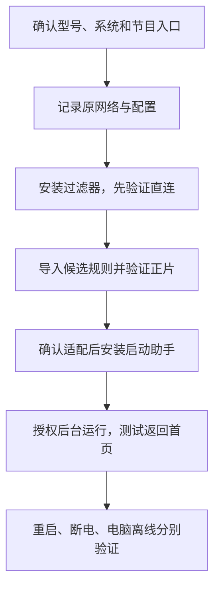

# 第一次使用，从这里开始

这份指南面向想让家人继续用原遥控器、从原电视首页看剧的人。请先看下面的适用范围，再决定怎样操作。

## 开始前先了解三件事

- 设置完成后的看剧入口仍是原电视首页。FlClash和启动助手是额外安装的后台工具，配置时需要打开它们。
- 第一次配置需要一台能运行终端工具的电脑，且需要有人在电视旁确认安装和权限。已有构建验证来自macOS，Windows完整流程尚未验证。
- 本项目处理已测播放链路的广告，会员专属内容仍按平台权限访问，开机广告另行处理。

如果你只想先了解是否适合自己，读完“我家的电视能用吗”和“准备四项信息”就可以把材料交给Agent，不必先学习后面的构建命令。

## 我家的电视能用吗？

目前完整实践来自创维75V58F Pro、酷开系统10.01.260911及本机酷喵播放链路。其他型号、其他系统版本需先检查，不能只凭“都是创维”判断。

在电视设置中找到“本机信息”或“关于本机”，记录型号与系统版本。再从首页打开一个免费节目，记录节目、集数、版权标识，以及广告属于开播前、播放中途还是暂停后。设置名称以电视实际显示为准。

版权图标可以帮助定位，仍需确认实际播放器与插件版本。这一步目前由技术人员或Agent通过设备信息核对；仓库没有一个普通用户可点击的自动检测器。

| 你的情况 | 从哪里继续 |
| --- | --- |
| 有能控制本机终端的Agent | 按下一节准备材料，让Agent先检查 |
| 熟悉终端和Android工具 | 按[技术执行流程](agent-workflow.md)操作 |
| 没有Agent，也不熟悉终端 | 可下载助手测试包，首次安装配置仍建议请熟悉Android的人协助 |

本项目提供[预编译测试APK与实机配图](illustrated-setup.md)，可省去助手构建。电视调试入口仍需按机型确认。仅下载YAML文件无法完成全部设置。

## 交给Agent前，准备四项信息

1. 电视型号和系统版本。
2. 一部免费可看的节目、集数及广告出现的位置。
3. 电视网络设置中的当前IP地址。电脑与电视连接同一家庭网络。
4. 是否允许临时打断播放，以及当前是否有人在使用遥控器。

IP只在本地交给自己的Agent。截图如含账号、激活ID或MAC地址，对外分享前先遮挡。无需向他人提供电视账号密码。

把仓库地址与下面任务一起交给Agent。

> 请阅读 https://github.com/koi-lee/tv-home-ad-filter-notes 的AGENTS.md、docs/quick-start.md和docs/agent-workflow.md。先只读检查我的电视型号、系统、实际播放器与插件版本，告诉我是否适配，以及还缺哪些工具。暂时不要改设置。确认适配并获得我的操作授权后，逐步完成直连基线、广告过滤、助手构建安装和恢复验证。每次先保存原值，出现联网或正片故障就恢复。安装、VPN与厂商后台权限由我本地确认。最终分别报告已验证与未验证场景。

## 先看懂几个名称

| 名称 | 在本项目中做什么 | 谁来处理 |
| --- | --- | --- |
| Agent | 读取文档、在电脑运行工具并协助排查 | 需有本机终端能力，纯文字聊天无法直接配置电视 |
| ADB | 让电脑连接已授权电视的调试工具 | Agent或技术协助者准备 |
| FlClash | 安装在电视上的本地过滤工具 | 用户确认安装和VPN授权，Agent配置 |
| YAML | 保存过滤规则的文本配置文件 | Agent导入，用户无需手改内容 |
| 启动助手 | 开机恢复过滤并返回原首页 | Agent构建安装，用户开启自启和后台权限 |

## 整个过程会发生什么？

第一次配置需要电脑辅助。验证完成后，过滤器和启动助手在电视上运行。电脑关闭后的使用效果必须实际测试，不能只凭进程已启动判断。

## 你在电视上需要做什么？

以下为本项目已走过的操作顺序。不是每台电视都显示相同菜单。

1. **开启设备调试并确认电脑连接。** 由Agent先确定你的机型正式入口。不要尝试其他品牌的隐藏按键，也不要进入工厂菜单修改画质或硬件参数。
2. **允许安装已核验的过滤器。** 安装前由Agent说明来源、版本及文件。出现系统安装询问时，只批准本次明确操作。
3. **允许本地VPN。** Android会弹连接请求。此处用于让过滤器处理电视本机流量。若已有其他VPN，先由Agent确认如何处理冲突。
4. **导入配置并检查运行。** 应先导入[直连基线 baseline.yaml](../examples/baseline.yaml)，验证正常联网；再导入[过滤配置 tv-filter.yaml](../examples/tv-filter.yaml)并开启对应配置。不同客户端版本菜单可能不同，由Agent按当前页面确认，不能只看“导入成功”就结束。
5. **安装启动助手。** 可从[配图指南](illustrated-setup.md)下载测试包，或按[助手说明](../helper/README.md)构建。助手默认不开机自启，需要在电视界面开启“开机自动恢复过滤并返回首页”，再选择“测试启动并返回首页”。
6. **授予后台权限。** 在本机应用后台管理中，为助手和FlClash分别允许自启动、保持后台运行。找不到选项时停下来核对页面，不要改无关应用权限。
7. **验收日常使用。** 用原遥控器回首页点节目，再分别测重启、拔电及电脑离线。

本机助手及后台权限步骤已有[实机截图](illustrated-setup.md)，配置导入已补充当前菜单、固定下载地址和逐步核对方法；完整导入截图与首次VPN授权图仍待匹配场景采集。上面的名称是本机记录，若页面不同，请由Agent读取当前页面或让协助者核对，不按想象点击。本文流程图只解释顺序。

## 每一步做到哪里再继续？

| 当前步骤 | 继续前应该看到什么 | 没达到时怎么办 |
| --- | --- | --- |
| 电脑连接电视 | Agent确认设备已连接并获授权 | 核对电视当前IP及本地授权，暂不安装 |
| 直连基线 | 原首页同一免费节目能正常出正片 | 先查网络与配置，暂不加过滤规则 |
| 过滤实验 | 目标片段正常，广告/倒计时/加载分别有记录 | 网络错误或持续黑屏时恢复直连基线 |
| 助手手动测试 | 四项参数核对成功、过滤器运行、回到原首页 | Agent看失败原因，暂不报自启完成 |
| 重启与断电 | 开机后无需手动开工具，仍能从首页播放 | 保留手动使用路径并记录自启失败 |

## 怎样算设置好了？

- 首页和遥控器使用方式正常，目标免费内容能出正片。
- 测试窗口没有视频广告与广告倒计时。加载、持续黑屏和正片各自记录，不能把黑屏算去广告成功。
- 重启后无需手动打开过滤器。
- 拔电约20秒再开机后也能正常使用。
- 电脑断网后电视仍能播放。

第一次测试同一集，之后再试暂停、换集和曾出现中插的位置。详情页会员横幅、下一集预告倒计时与插播广告分别记录。短时没看到广告只说明该窗口的观察结果。

[本项目已经测了哪些](validation.md)及[2026年11月21日新构建验证](agent-review.md)都有范围说明。MIT授权允许修改与商用并保留许可证，但不代表其他设备已经兼容。

完成后让Agent留下原值和恢复记录，并把它保存到你能找到的本地文件夹。日后固件或播放器升级、网络变化、广告再次出现时，从这份记录继续排查。没有必要为检查本方案反复重启或常开电脑。

## 如果电视变慢或播不了怎么办？

先记录当前节目、页面和发生时间，然后按下面顺序处理。

1. 打开FlClash，使用正常的停止按钮关闭过滤，再从原首页打开同一节目。
2. 若配置期间改过电视DNS或IP，按操作前记录恢复。原来使用动态IP就恢复动态，不要复制别人家的地址。
3. 如果Agent已经写入播放器属性，先关闭启动助手的开机开关，防止重启后再次写入；让Agent按记录逐项恢复四个原值，然后重开播放器核对。
4. 恢复后仍异常，先让Agent检查网络和真实错误。不要自行卸载系统播放器、清账号数据或恢复出厂设置。

如果你没有保存原值，先停止继续试规则，让协助者核对现状。完整命令和同签名覆盖限制见[部署与回退](setup.md)、[助手说明](../helper/README.md)。本项目已测旧0.3同版本包覆盖回退，卸载后全新安装和完整清除适配状态尚未在本轮测试。

## 找人帮助时怎么描述？

可以写“型号/系统版本、节目与集数、首页进入方式、发生在开播/中途/暂停、看到广告还是黑屏、停止过滤后能否恢复”。不要公开原始日志和播放链接；由Agent提取必要脱敏摘要。仓库记录的是个人实践，维护者没有承诺逐台远程安装服务。
